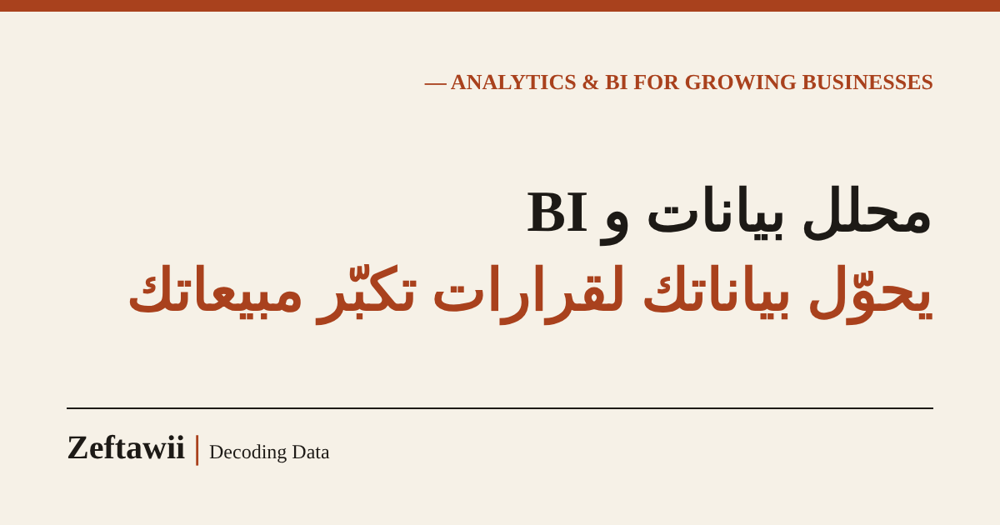

<div align="center">



# Zeftawii | Decoding Data

**Bilingual (Arabic RTL + English) lead-generation website for a data analyst and account manager.**

[](https://zeftawii-site-bkxt.vercel.app/)
[](https://astro.build)


[العربية](#-ملخص-بالعربي) · [Live site](https://zeftawii-site-bkxt.vercel.app/) · [English version](https://zeftawii-site-bkxt.vercel.app/en/)

</div>

---

## What this is

A single-page service site (not a portfolio) built to turn visitors into inbound leads for **Albaraa Ehab Elzeftawy**: data analysis and BI, marketing analytics, report automation, smart tools, and outsourced account and project management for businesses in Saudi Arabia and Egypt.

The visitor path is simple: understand the offer, see proof, and contact via WhatsApp, a lead form, a booking link, or email.

## Features

**Conversion**
- Hero with a clear promise, three trust points and a primary CTA
- Services carousel (CSS scroll-snap, arrows, dots, swipe, RTL-aware) with a per-service "Request" button that pre-selects the service in the form
- "Who it is for" pain and fix cards, "Selected work" proof cards, process, why-me with photo, FAQ
- Lead form (Web3Forms) with honeypot spam protection and automatic WhatsApp fallback when no key is set
- Built-in assistant chatbot (rule-based, no server, no cost): answers from site content in Arabic or English, then collects name, contact and service and sends the lead via Web3Forms (or WhatsApp fallback). Edit its answers in `src/chatKB.ts`
- Floating WhatsApp button and a booking button that hides itself while the link is still a placeholder

**SEO**
- Static HTML in two languages: `/` (Arabic) and `/en/`
- Canonical, `hreflang` (ar / en / x-default), Open Graph and Twitter large-card tags
- JSON-LD `@graph`: WebSite, Person, ProfessionalService (with offer catalog), WebPage, FAQPage
- `sitemap.xml` with alternates, `robots.txt`, `llms.txt`, web manifest, `noindex` 404 page
- Async font loading, long-cache headers for static assets, security headers

**Quality**
- Responsive from 360px to desktop, logical CSS properties for RTL and LTR
- Keyboard-friendly, skip link, visible focus states, `prefers-reduced-motion` respected
- Content stays visible if JavaScript fails
- Optional analytics (GA4 and Microsoft Clarity) with named conversion events

## Lead intake (form, chatbot, WhatsApp)

All three channels share one library (`src/lib/lead.ts`): the same validation (Arabic digits normalized, phone/email checks), a short reference number per request (`ZF-XXXX`), UTM and referrer capture, duplicate and cooldown protection, a honeypot plus minimum-fill-time check, timeout with one retry, and a WhatsApp fallback that carries the full request if sending fails. Plain WhatsApp buttons get a context line (source, selected service, reference) added on click.

## Chatbot (static, no API)

The chatbot is fully static: no AI, no server, no keys. Every answer and every guided consultation is written by hand in `src/chatKB.ts` (Arabic `ar` and English `en`). To add or change an answer, edit an entry (`k` = keywords, `a` = answer, `v` = per-topic variants, `chips`, `act`). Guided consultations live under `flows`: each has questions with options and a tip per option. Keep the chip labels equal to a keyword of the entry they should open.

The bot can also learn from real visitors, for free and under your review: see `docs/chat-log.md` (anonymous Google Sheet log of unanswered questions and 👍/👎 feedback).

## Tech stack

| Layer | Choice |
| --- | --- |
| Framework | [Astro](https://astro.build) 7, fully static output |
| Styling | One hand-written CSS file (design tokens, glassmorphism "Tech Noir" theme) |
| Interactivity | Vanilla TypeScript in a single script (carousel, reveal, form, tracking) |
| Fonts | Orbitron, IBM Plex Sans Arabic, IBM Plex Mono (Google Fonts, non-blocking) |
| Forms | [Web3Forms](https://web3forms.com) (free) |
| Booking | Cal.com link (free) |
| Hosting | Vercel today, Cloudflare Pages recommended for commercial use |

## Project structure

```
.
├── astro.config.mjs          # site URL, static build
├── vercel.json               # security + cache headers (Vercel)
├── public/
│   ├── _headers              # same headers for Cloudflare Pages
│   ├── og-image.png          # 1200x630 social card
│   ├── albaraa.jpg, albaraa-320.jpg
│   ├── favicon.svg, favicon-48.png, apple-touch-icon.png, icon-192/512.png
│   ├── manifest.webmanifest
│   ├── robots.txt, sitemap.xml, llms.txt
└── src/
    ├── config.ts             # ALL editable settings (start here)
    ├── i18n.ts               # ALL copy, Arabic and English
    ├── layouts/Base.astro    # <head>, meta, JSON-LD, analytics
    ├── components/Landing.astro   # the page (shared by both languages)
    ├── pages/index.astro     # Arabic
    ├── pages/en/index.astro  # English
    ├── pages/404.astro
    └── styles/global.css
```

## Quick start

```bash
npm install
npm run dev       # http://localhost:4321
npm run build     # static output in dist/
npm run preview   # serve the build locally
```

Requires Node 22.12 or newer (Astro 7).

## Configuration

Everything you normally change lives in [`src/config.ts`](src/config.ts):

| Key | What it does |
| --- | --- |
| `whatsapp` | International format without `+` (for example `201001234567`) |
| `web3formsKey` | Free key from web3forms.com. Leads arrive by email. While it is a placeholder, the form opens WhatsApp with a prefilled message |
| `bookingUrl` | Your Cal.com or Calendly link. The button is hidden while it still contains `your-username` |
| `ga4Id` | Optional GA4 measurement ID (`G-XXXXXXXXXX`). Empty means no tracking |
| `clarityId` | Optional Microsoft Clarity project ID (free heatmaps and recordings) |
| `links` | Social profiles. Empty values disappear from the footer automatically |
| `site` | Public URL, used for canonical, sitemap and schema |

All text, services, FAQ, stats and proof cards are in [`src/i18n.ts`](src/i18n.ts), one block per language.

## Deploy

**Vercel**: import the repo, framework preset Astro, defaults are fine. Note that the Hobby plan is for non-commercial use.

**Cloudflare Pages** (recommended for a business site):
1. Workers & Pages, Create, Pages, Connect to Git
2. Framework preset: Astro, build command `npm run build`, output directory `dist`
3. Optional: attach a custom domain under Custom domains

No code changes are needed to switch between them.

### After the first deploy

1. Verify the site in **Google Search Console** (HTML file method: put the file in `public/`, never delete it)
2. Submit `sitemap.xml`, then use URL Inspection, Request indexing for `/` and `/en/`
3. Validate structured data with Google's Rich Results Test
4. Replace the placeholder `bookingUrl` and `web3formsKey`

### Moving to a custom domain

Update the URL in these four places, then resubmit the sitemap:

1. `src/config.ts` (`site`)
2. `astro.config.mjs` (`site`)
3. `public/robots.txt` (Sitemap line)
4. `public/sitemap.xml` (all `<loc>` and alternate links)

## Analytics events

When `ga4Id` is set, these events are sent automatically:

| Event | Fired when |
| --- | --- |
| `cta_click` | Hero, navbar or footer CTA clicked |
| `service_click` | "Request this service" on a service card |
| `whatsapp_click` | Any WhatsApp button or link |
| `booking_click` | Booking button |
| `email_click` | Email link |
| `github_click`, `portfolio_click` | Proof section links |
| `chat_open`, `chat_lead_start` | Chatbot opened / lead flow started |
| `generate_lead` | Form or chatbot lead submitted (parameters: `method`, `service`, `budget`) |

Mark `generate_lead` as a key event in GA4 to measure conversion rate.

## License

Copyright (c) 2026 Albaraa Ehab Elzeftawy. All rights reserved. The text, photo, branding and design belong to the author. Please get in touch before reusing them.

---

## 🇪🇬 ملخص بالعربي

موقع خدمات ثنائي اللغة (عربي RTL افتراضي + `/en/`) مبني بـ **Astro** وستاتيك بالكامل، هدفه تحويل الزوار لعملاء محتملين، مش بورتفوليو.

**اللي بتعدله بنفسك**
- `src/config.ts`: رقم الواتساب، مفتاح الفورم، لينك الحجز، الـ Analytics، روابط السوشيال، رابط الموقع.
- `src/i18n.ts`: كل النصوص بالعربي والإنجليزي (الخدمات، الأرقام، الأسئلة الشائعة، نماذج الشغل).

**تشغيل محلي**
```bash
npm install
npm run dev
```

**النشر:** Vercel (للاستخدام غير التجاري) أو Cloudflare Pages (الأنسب لموقع تجاري). نفس الكود بيشتغل على الاتنين.

**بعد النشر:** وثّق الموقع في Google Search Console، ابعت `sitemap.xml`، وغيّر `bookingUrl` و`web3formsKey` من القيم المؤقتة.

**لما تربط دومين خاص:** غيّر الرابط في 4 أماكن: `src/config.ts` و`astro.config.mjs` و`public/robots.txt` و`public/sitemap.xml`.
